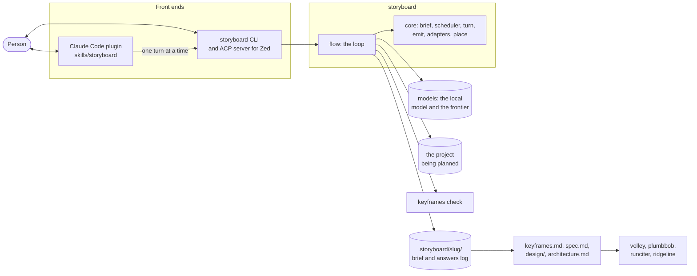
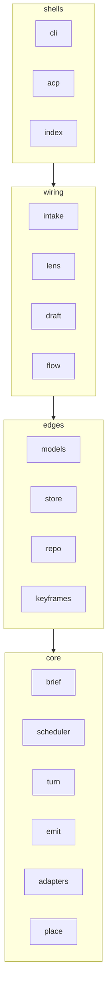

# storyboard: architecture

This is the map the first build fills. It follows [the sketch](specs/initial_sketch.md): one
planner, one loop over one brief, and lenses instead of agents. Two files hold the map, and the
gate runs both:

- **`fallow.toml`** holds the rings: which ring each module is in, and which rings it may
  import.
- **`rules/`** holds the doors: the one module allowed each effect.

If this page and those files disagree, the files are what the gate enforces, so fix this page.
A module's ring changes in both places, in one commit.

Until storyboard has a `keyframes.md` of its own, this page stands in for its Map.

## The containers



- **The brief is the state.** It lives in files, so a turn can run from the CLI, from Zed over
  ACP, or from the Claude Code skill, and a session started in one can carry on in another.
- **Only the main loop asks.** Subagents keep three jobs: reading a repo into a summary,
  rendering design tiles, and sampling competing drafts.
- **Local first.** The local model classifies intake and samples drafts; the frontier model asks
  and drafts. No telemetry.

## The rings



A ring may import any ring below it. An edge imports only the core, never another edge.

| Module | Ring | Owns | Build step |
| --- | --- | --- | --- |
| `brief` | core | The record: each lens's slots as typed slots, the answers log's entries, their replay into the slot board (Clear, Partial, Missing), and `brief.md` rendered from it | 1 |
| `scheduler` | core | The next lens and its questions, by impact × uncertainty; the caps per round and per lens; the stopping rule | 1 |
| `turn` | core | One step: the session and one event go in; the log entry it adds, the brief after it and what comes next come out, from intake to accepted | 1, 2 |
| `emit` | core | The emitters: `keyframes.md` from a draft's Intent and items, in keyframes' usual form, so far, then `spec.md`, design tokens and tiles, `architecture.md`; drafts cut into playback chunks of one section and 30 lines at most | 2, 4–6 |
| `adapters` | core | Templates over the brief for volley, plumbbob, runciter and ridgeline. Not model calls | 4 |
| `place` | core | For an existing project, each item's placement (core, part or log) and a reason; the plan's budgets | 3 |
| `models` | edge | The only door to a model: one fascicle engine, Ollama for the local model and Anthropic for the frontier one, both on the native transport. Four calls, each a `model_step` with its own system prompt and zod schema: `classify` (local: intake's answers into the work's kind and size), `interpret` (answers into slot updates, each with its status), `phrase` (the scheduler's slots and their bank questions into one to four questions) and `draft` (the brief, the rubric and any findings or corrections into the Intent and items). A reply that fails its schema is refused, never guessed at | 2 |
| `store` | edge | The only writer: `.storyboard/<slug>/` during the interview, and the accepted files after it | 1, 2 |
| `repo` | edge | Reads a project, its docs, its decisions and the shape of its code, into a summary with sources | 3 |
| `keyframes` | edge | The only subprocess: `keyframes check --strict --json` on each staged plan, run from storyboard's own dependency, giving the exit code, the counts and the findings, or no verdict | 2 |
| `intake` | wiring | The first lens's three open questions, then their answers sent to the local model for the work's kind and size, which decide the lenses and the ceremony. So far only a tiny size changes what happens: it ends the session with no planner | 2 |
| `lens` | wiring | Loads a lens from [`lenses/`](../lenses/README.md): its slots, what makes each one Clear, its question bank and its drafting rubric, refusing a lens that doesn't read with its file and line | 2 |
| `draft` | wiring | Drafts every artifact from the brief: so far `keyframes.md`, drafted through `models`, emitted, staged and checked, sent back once with what the check found when it fails, and cut into playback chunks with whatever still fails as a chunk of its own. On accept it checks the staged draft again and copies it only when it's clean. Later, it samples competing drafts to find what to ask | 2, 7 |
| `flow` | wiring | One `storyboard turn` call: it loads the session, takes what the person said (answers, read into slot updates through `interpret`, or a reply to a chunk of the draft, which passes it when blank and otherwise is a correction read the same way), then carries out what a model can (intake's questions, the classification, the next round phrased, the draft) until it's the person's turn. Each entry is appended as the core takes it, and `brief.md` is rendered at the end. An accept writes `keyframes.md` only when the playback ended with nothing corrected and the check is clean. A call is a straight line, so it awaits each step rather than composing fascicle's primitives, and a session spans calls through its files, not fascicle's `suspend` | 2 |
| `cli` | shell | The `storyboard` command, which the bin runs: `storyboard turn [slug] [--dir <project>] [--json] [--done] [--accept]` runs one turn of the interview, its answers on stdin as JSON keyed by id, and prints what comes next as text or JSON. It reads the four model settings from the environment and takes the models as an argument, which the bin gives as the real ones | now, 2 |
| `acp` | shell | The ACP server for Zed, over fascicle's | after the CLI |
| `index` | shell | The package's public surface | now |

Build steps are the sketch's [build order](specs/initial_sketch.md#build-order-when-its-time).
Only `cli`, `index`, `brief`, `scheduler`, `turn`, `emit`, `keyframes`, `store`, `lens`, `models`, `intake`, `draft` and `flow` exist so far; every other module is created by the step that needs it.

### What each ring may do

| Ring | May import | Also held to |
| --- | --- | --- |
| core | other core modules | No files, processes, network, clock, randomness, environment or fascicle: `fs`, `child_process`, `fetch`, `Date.now`, `Math.random`, `process` and `fascicle` calls all fail the gate |
| edges | the core | Its own door, below |
| wiring | the core and the edges | No door of its own: it reaches a model through `models` and writes through `store` |
| shells | everything | Thin: parse the input, call the flow, print the result, return an exit code |
| tests | everything | Nothing. `src/**/__tests__/` and `test/` are a zone of their own, so a core module's tests can read fixtures |

The core is held hardest because it's where storyboard is hard to get right and cheap to test.
The sketch's first build step is "the scheduler as plain code under tests", and a pure turn means
a session replays from its files after a crash.

Every file in `src/` must belong to a ring. A file in none of them fails the gate, so a module
can't land off the map.

## The doors

| Effect | Only in | Rule |
| --- | --- | --- |
| Writing files | `store` | `writes-only-in-store` |
| Starting a process | `keyframes` | `subprocess-only-in-keyframes` |
| A model call, or the network | `models` | `model-calls-only-in-models` |

Reading files is open to every ring but the core: `store`, `repo` and `lens` all read, and the
CLI reads `package.json`. fascicle's composition primitives are open to the wiring; only its
model surface (`create_engine`, `model_call`, `model_step`) is held to `models`.

Each effect has one place to look, one place to fake in a test, and one place to ration.

## Adding a module

1. Decide its ring. If it doesn't fit one, that's a question for a person, not a new ring.
2. Add its name to that zone in `fallow.toml`, which lists both forms, `src/<name>.ts` and
   `src/<name>/**`. Add its row to the table above in the same commit.
3. Start it as a file. When it grows internals worth hiding, make it a folder whose only public
   surface is `index.ts`; siblings import that, never the internals.
4. Run `pnpm check`.

If a module needs an effect its ring doesn't allow, that's a change to the map. Raise it rather
than working around a rule.

## Front ends

Both stay thin, and neither holds state of its own.

- **The CLI** is `bin/storyboard.js`, which runs `src/cli.ts`. That returns an exit code and
  never exits the process itself: 0 for a turn that ran, 1 for an accept the check refused, and 2
  for a usage problem, a missing setting or a turn that can't go on. Each `storyboard turn` is
  one turn, so both front ends drive the same command and a session moves between them by its
  files alone. The ACP server for Zed will be `src/acp.ts`, over fascicle's.
- **The Claude Code plugin** is `.claude-plugin/plugin.json` and
  [`skills/storyboard/`](../skills/storyboard/SKILL.md). The skill asks, with
  `AskUserQuestion` and previews, and the CLI runs each turn. It ships in the same npm package,
  as plumbbob's does.

## On disk

In the project being planned, during the interview:

```text
.storyboard/<slug>/
  answers.jsonl  one JSON line per event of the core: what was asked, the answers word for word,
                 the slot updates read from them, and the draft's playback; appended, never
                 rewritten. Each line carries `call`, the number of the `storyboard turn` call
                 that wrote it, counting from 1, so the lines group into one exchange per call
  brief.md       every slot, its status and its value, rendered from the log every turn and never
                 read back
  draft/
    keyframes.md the latest draft, staged here because `keyframes check` reads a folder; each
                 draft is written over the one before
```

On acceptance, the emitted files go where their readers expect them: `keyframes.md` at the root,
`spec.md`, `design/` and `architecture.md`, plus whatever the chosen adapters need. Nothing is
written until the person accepts, and accepting never writes over a file that's already there:
`keyframes.md` is copied from the staged draft, and refused if the project has one.

## In this repo

| Path | Holds |
| --- | --- |
| `src/` | The modules above |
| `lenses/` | Lens content: slots, question banks, rubrics |
| `skills/`, `.claude-plugin/` | The Claude Code front end |
| `bin/` | The `storyboard` command |
| `rules/`, `rule-tests/` | The doors, and a fixture for each proving it fires |
| `test/` | Tests across modules: `integration/`, `e2e/`, `contract/`, `helpers/`, `fixtures/` |
| `docs/specs/` | The sketch, and specs as they're written |
| `docs/research/`, `docs/diagrams/` | Research passes and diagrams |
