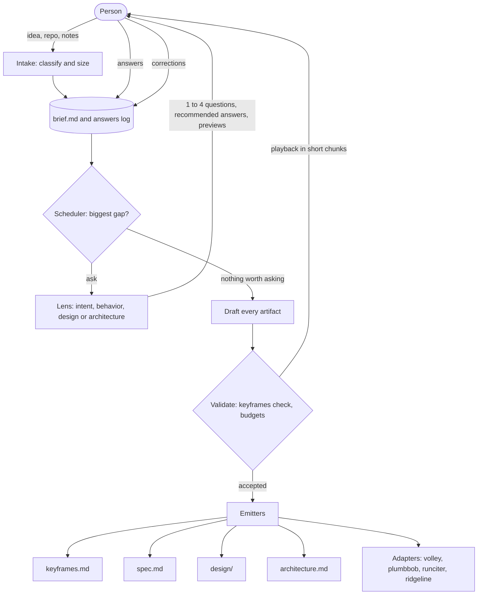

# storyboard: a sketch

2026-10-27. A sketch for keyframes' I6 (drafting-interview), not a plan. It draws on two research
passes run today: one over Rob's own repos (ridgeline, plumbbob, runciter, volley, fascicle,
trellis, night-shift), and one over industry tools, open source and papers.

The planner is named storyboard, and it will publish as `@robmclarty/storyboard`.

## The idea

storyboard interviews a person the way 20 questions works: open and broad first, then narrow, each
question chosen to cut the most uncertainty, until it knows enough to draft. Then it drafts first
versions of what the rest of the toolchain builds from: `keyframes.md` for intent, `spec.md` for
behavior, design tiles and tokens for how it looks, and a map of the parts. A person corrects
them; nothing is signed blind. The outputs feed volley, plumbbob, runciter, ridgeline or a
person.

## What already exists

- **Ridgeline's front half is most of this.**
  - **`shape`** is a broad-to-narrow interview: up to four rounds of three to five questions, each
    with a suggested answer, after reading the repo (`src/agents/core/shaper.md`,
    `src/commands/qa-workflow.ts`).
  - **`design`** is its own Q&A.
  - **`directions`** drafts palettes and tokens with a demo page (`docs/directions.md`).

  Ridgeline hasn't had a commit since 2026-06-12, and runciter's R11 says "Ridgeline is gone". So
  this is code to harvest, not a tool to extend.
- **plumbbob's `/plumbbob:plan`** interviews too, but about steps: how to build a thing in small
  pieces. It already absorbs a spec file, so storyboard's `spec.md` is its input, not its rival.
- **Three smaller precedents:**
  - **trellis** asks pitch and intake questions and checks six kinds of ambiguity;
  - **night-shift's `plan-draft`** drafts a plan with no human and grades it;
  - **runciter's `researcher`** turns an idea into a one-pager with criteria.
- **Two precedents read an existing project instead of an idea.** ridgeline's `ingest` drafts
  with no questions and lists what it guessed under `## Inferred / Gaps` (`docs/ingest.md`).
  faultline reverse-engineers a codebase into specs, an architecture, constraints and taste.
- **Nobody has built the intake router.** The 2026-10-07 orchestration survey proposed it as a
  fascicle verb. storyboard's intake step would be its first real use.

## Recommendation: one planner, one loop, lenses instead of agents

Build storyboard as one planner: one interview loop over one shared record, the **brief**. The
specialists become **lenses**: skills that each own some slots, a question bank and a drafting
rubric, loaded when their slots hold the biggest gap. Don't build a router that hands the
conversation to separate agents, and don't build separate projects.

1. **Hand-offs lose what the person said.**
   - Role-to-role pipelines show "often minimal" gains (MAST).
   - What helped MetaGPT was structured artifacts, not the roles.
   - Anthropic's newest guidance, as reported by the web pass, folds subagents back into one loop
     that loads skills on demand.
2. **Only the main loop can ask.**
   - In Claude Code, subagents can't call `AskUserQuestion`.
   - fascicle has no free-text ask primitive at all.
3. **The questions overlap.** "Who is it for?" serves intent, behavior and design at once.
   Separate planners would each ask it.
4. **It's the toolchain's own grain:**
   - a deterministic orchestrator, with model calls rationed (fascicle `VALUES.md`);
   - markdown and git as the record (runciter R2, keyframes D1).

The router survives, smaller: it routes each next question, not the whole conversation.
Subagents stay for three jobs that need fresh context or run in parallel:

- reading the repo into a summary;
- rendering design tiles;
- sampling the competing drafts that decide what to ask.

### One project or several

| Option | Gets | Costs | Call |
| --- | --- | --- | --- |
| **One planner, lenses as skills** | One conversation, one brief, one set of emitters | The design lens may outgrow it | **Build this**, with the design lens behind a seam it can leave by |
| A router plus specialist agents | Parallel drafting, separate modules | Lossy hand-offs; subagents can't ask; 3–10× the tokens | Only for the three isolated jobs above |
| A project per specialist | Each one tiny | The person answers overlapping questions in three tools, with three states | No |
| Fold it into ridgeline, plumbbob or volley | Reuse | Ridgeline is retired; plumbbob's plan is about steps and should stay small; volley leaves planning to its builder on purpose | Harvest ridgeline's shaper, designer and directions; feed plumbbob and volley |
| Put it in keyframes | One install | Breaks keyframes' Intent ("Not: a code generator") and C1's read-only checker | No. storyboard runs `keyframes check`; keyframes never runs storyboard |

## How it works

- **The brief is the state.**
  - Every turn is one pure step: the brief and an answer go in, an updated brief and the next
    questions come out.
  - The brief lives in files: `.storyboard/<slug>/brief.md` and an answers log. So a turn can run
    from a CLI, from Zed over fascicle's ACP server, or from a Claude Code skill.
  - A session survives a crash, and fascicle's `suspend`, which replays from the start on every
    resume, is never needed.
- **Intake** asks at most three open questions, with no menus, because options steer:
  1. What is it, and who's it for?
  2. What would make it a success, and how much time is it worth?
  3. What must it never do?

  Then it classifies the work (product, feature, library, game, content, event) and its size,
  which decides the lenses and how much ceremony to use. A one-line fix gets no planner.
- **The scheduler** marks every slot Clear, Partial or Missing, and asks next about the one with
  the highest impact × uncertainty, as Spec Kit's `/clarify` does. Once there's enough to draft,
  it asks only where cheap drafts disagree:
  - it samples two or three drafts on the local model, each under different assumptions;
  - it asks about whatever splits them, offering each draft's choice as an option (ClarifyGPT,
    Active Task Disambiguation).
- **Broad, then narrow.** Early questions are open. Later ones offer two to four options, with a
  recommended answer and "something else". Design questions carry previews.
- **Stopping.**
  - At most four questions a round, and about five per lens.
  - It stops and drafts when the person says "done", or when no question is worth its cost.
  - A slot still open at the cap becomes an open Question, with the recommended default beside
    it. It never becomes a guessed Decision; that's plumbbob's hard contract.
- **Playback.** Drafts come back in short chunks, each ending "what's wrong or missing?", so the
  person reviews a page at a time, not 2,500 lines.

## The slots

| Lens | Slots | Lands in |
| --- | --- | --- |
| Frame | Problem, who it's for, appetite, no-gos, what done looks like, prior art and existing code | Intent prose; no-gos become Constraints |
| Intent | Principles, constraints, decisions (options considered, and why), taste, open questions, ideas | `keyframes.md`: P, C, D, T, Q, I |
| Behavior | Scenarios and features, acceptance criteria, what's out of scope, the check command | `spec.md`, and Scenarios in `keyframes.md` |
| Design | The feel, references, palette, type, density, voice, and a pick among style tiles | `design/` tokens and tiles, and Taste items |
| Architecture | The parts, what each is for, how they connect, where each lives | `architecture.md`, and Map items |

**Architecture** means the structure of whatever is planned:

- services, for software;
- systems and the core loop, for a game;
- modules, for a course;
- flows and roles, for an event.

It's one text model, in Mermaid because models write it fluently, kept to the context and
container levels so it stays true.

**Design** works the way style tiles do: fonts, colors and a few elements, looser than a mockup.

- The lens renders two or three tiles as HTML: previews in Claude Code, files in a browser
  elsewhere.
- The person picks one, or mixes them.
- The pick is written as W3C design tokens (format 2025.10), plus Taste items.
- The lens names the generic defaults it's steering away from.

## Outputs

Every builder Rob uses can take a block of acceptance criteria and one check command. Each adapter
is a template over the brief, not a model call.

| Target | Gets |
| --- | --- |
| keyframes | `keyframes.md` at the root, plus a plan beside each part that earns one, each clean under `keyframes check` and inside its budgets |
| The log | For an existing project, its decision history: left where it is, or started as `docs/decisions.md` |
| plumbbob | `spec.md`, handed to `/plumbbob:plan spec.md` |
| volley | `prompt.md` and `criteria.md`, run with `--check auto` |
| runciter | A `create_task` intent: title, body and criteria |
| ridgeline, if revived | `spec.md`, `constraints.md` with a `## Check Command`, `taste.md` and `design.md`, as `spec-to-ridgeline` maps them |
| A person | The same files, read top to bottom |

## Existing projects

storyboard can start from a project that already exists, not only from an idea. This is keyframes'
I7 (brownfield-split), and it follows two decisions in keyframes' own plan:

- **D8 (grow-by-scope):** a plan that outgrows its budgets splits by scope instead of raising them.
  The root plan keeps the core, and a part with reason to stand alone gets its own plan beside its
  code, which cites the root and adds to it without overriding it.
- **D9 (log-apart):** the plan holds only what's in force, and the history of decisions lives in a
  log outside it.

### What it reads

- Everything that already says what the project intends:
  - the README, `AGENTS.md` and `CLAUDE.md`;
  - specs and design docs;
  - decision records, such as plumbbob's `docs/decisions.md`: 109 decisions and 7 constraints, in
    22k words;
  - an existing `keyframes.md`, if there is one.
- The shape of the code: packages, folders and modules, which are the candidates for the Map's
  parts and for plans of their own.

A subagent does the reading and hands back a summary with sources, so the interview's context
stays small. This is one of the three jobs subagents keep.

### What it proposes

Every item it finds, whether a decision, a constraint or a rule, gets one placement and a reason
in a clause:

| Placement | Means | Goes to |
| --- | --- | --- |
| **core** | Holds everywhere | The root plan |
| **part** | Holds only inside one part | That part's plan |
| **log** | History: a superseded call, or a detail that isn't a standing rule | The log, untouched |

An item that looks stale, or that the code contradicts, isn't dropped: it becomes an open
Question, with the evidence beside it. Each proposed item names its source, such as
"plumbbob D12", so the person can trace it back to the log.

### The rules it keeps

- **The root plan stays inside its budgets:** 20 active decisions, 12 constraints, 2000 words, and
  the rest. Over a budget means moving items to a part or the log, never raising the budget.
- **A part earns its own plan only with a reason.**
  - It's a path the root plan's Map claims, such as a deep module, a package or a skill's folder.
  - It has rules that don't hold anywhere else.
  - Its plan's Intent says why it stands alone.
  - A part with only one or two rules of its own keeps them in the root plan.
- **A part's plan cites the root and only adds to it.** It never restates a core item. If one of a
  part's rules contradicts the core, that's an open Question for the person, not a silent
  override.
- **The log isn't rewritten.** An existing log stays as it is, and the plans cite it rather than
  copy it. A project with no log gets one only if storyboard finds history worth keeping, in docs,
  commits or comments.

### How the person decides

- **One table, like a plumbbob harvest.** Every item appears with its proposed placement and the
  reason.
- **One reply settles it:** "looks good", or a change such as "make D12 core".
- **Questions only where a placement is unclear,** such as a decision that could be core or part.
  These go in the usual rounds, with the recommended placement as the default answer.
- **Nothing is written until the person accepts.** Then storyboard writes the root plan, each
  part's plan and any change to the log, and runs `keyframes check` on each file.

Until keyframes' `check` reads a split, which waits for its pilots, each file is checked alone, and
a part's citations to the root read as broken. storyboard reports those as expected, not as
failures.

### The first test is plumbbob

The keyframes pilot playbook has Rob write plumbbob's root plan by hand, keeping
`docs/decisions.md` as the log. storyboard's split of the same project is scored against his:

- the share of his core items it also put in the core;
- the share of its core items he kept.

The misses become the rubric for its placement step. It isn't trusted on other repos until the
two mostly agree.

## Where it lives

- **A new repo beside volley:** `~/Projects/storyboard/code/storyboard/`, published as
  `@robmclarty/storyboard`. It holds:
  - a fascicle flow;
  - lenses as `SKILL.md` folders;
  - emitters as plain functions;
  - two front ends, a CLI/ACP server and a Claude Code skill.
- **The name:** in animation, storyboards come before keyframes, and they're drawn broad before
  they're tight.
- **Local-first.**
  - The local model (qwen3.6:35b on the mini) classifies intake and samples drafts.
  - The frontier model asks and drafts.
  - No telemetry.

## When

keyframes' I6 says the drafting interview waits until after the pilots, because a drafted plan
would muddy H1: can an owner write a plan from the template alone? So run the pilots with plans
written by hand, and build storyboard after the closing call. If it's built sooner, keep it out
of the pilot repos.

## Build order, when it's time

1. The brief's schema and the slot board, with the scheduler as plain code under tests.
2. Intake, the intent lens and the keyframes emitter, checked by `keyframes check`. Test it by
   redrafting one pilot repo's plan and comparing the two.
3. Existing projects: read a repo and its docs, propose each item's placement, and on acceptance
   write the root plan, the part plans and any log. Score it on plumbbob against Rob's hand-written
   root plan.
4. The behavior lens, the spec emitter, and the plumbbob and volley adapters.
5. The design lens: tiles and tokens.
6. The architecture lens.
7. Divergence sampling, asking only where drafts disagree. Add it once the plain scheduler is shown
   to over-ask.

## Open questions

- For a new idea in an existing repo, does storyboard read the repo before it asks, as ridgeline's
  shaper does, or start from the person's words alone? (To split an existing project, it must
  read first.)
- Where does a part's plan live when the part isn't a folder, such as a concern that cuts across
  modules?
- How does an item drawn from a log keep its trace back to the entry without spending the plan's
  word budget?
- Does the design lens belong in the first version, or after intent and behavior prove out?
- Which front end comes first: a Claude Code skill (fastest, with the richest previews) or ACP in
  Zed (local models, and Rob's own harness)?

## Sources

From the local pass:

- ridgeline: `src/agents/core/shaper.md`, `src/commands/qa-workflow.ts` and `docs/directions.md`.
- plumbbob: `skills/plan/SKILL.md`.
- runciter: `docs/specs/runciter-pipelines-spec.md` (R6, R11).
- fascicle: `docs/human-in-the-loop.md` and `src/acp/`.
- volley: `README.md`.
- trellis: `skills/run/references/intake-questions.md`.
- night-shift: `prompts/plan-draft.md`.

From the web pass. These links come from the research agent and weren't re-checked by hand:

- **Spec-driven tools.**
  - Spec Kit's `/clarify`:
    <https://raw.githubusercontent.com/github/spec-kit/main/templates/commands/clarify.md>
  - Böckeler on spec-driven tools:
    <https://www.martinfowler.com/articles/exploring-gen-ai/sdd-3-tools.html>
  - The Spec Kit trial (2,577 lines for one feature):
    <https://blog.scottlogic.com/2025/11/26/putting-spec-kit-through-its-paces-radical-idea-or-reinvented-waterfall.html>
  - OpenSpec: <https://github.com/Fission-AI/OpenSpec>
- **Multi-agent evidence.**
  - MAST: <https://arxiv.org/abs/2503.13657>
  - MetaGPT: <https://arxiv.org/abs/2308.00352>
  - Anthropic, building effective agents:
    <https://www.anthropic.com/engineering/building-effective-agents>
  - Anthropic, folding subagents into the main loop:
    <https://claude.com/resources/articles/building-agents-when-to-fold-subagents-into-your-main-agent-loop>
  - Subagents can't ask the person: <https://code.claude.com/docs/en/agent-sdk/approvals>
- **Choosing questions.**
  - ClarifyGPT: <https://arxiv.org/abs/2310.10996>
  - Active Task Disambiguation: <https://arxiv.org/abs/2502.04485>
  - Uncertainty of Thoughts: <https://arxiv.org/abs/2402.03271>
  - GATE: <https://arxiv.org/abs/2310.11589>
  - MediQ, where naive asking hurt: <https://arxiv.org/abs/2406.00922>
- **Interviewing practice.**
  - Superpowers brainstorming:
    <https://raw.githubusercontent.com/obra/superpowers/main/skills/brainstorming/SKILL.md>
  - Shape Up pitches: <https://basecamp.com/shapeup/1.5-chapter-06>
  - Harper Reed's one-question-at-a-time workflow:
    <https://harper.blog/2025/02/16/my-llm-codegen-workflow-atm/>
- **Design and diagrams.**
  - Style tiles: <https://styletil.es/>
  - Design tokens 2025.10: <https://www.designtokens.org/tr/2025.10/>
  - Steering away from generic design:
    <https://claude.com/blog/improving-frontend-design-through-skills>
  - Mermaid C4: <https://mermaid.js.org/syntax/c4.html>
